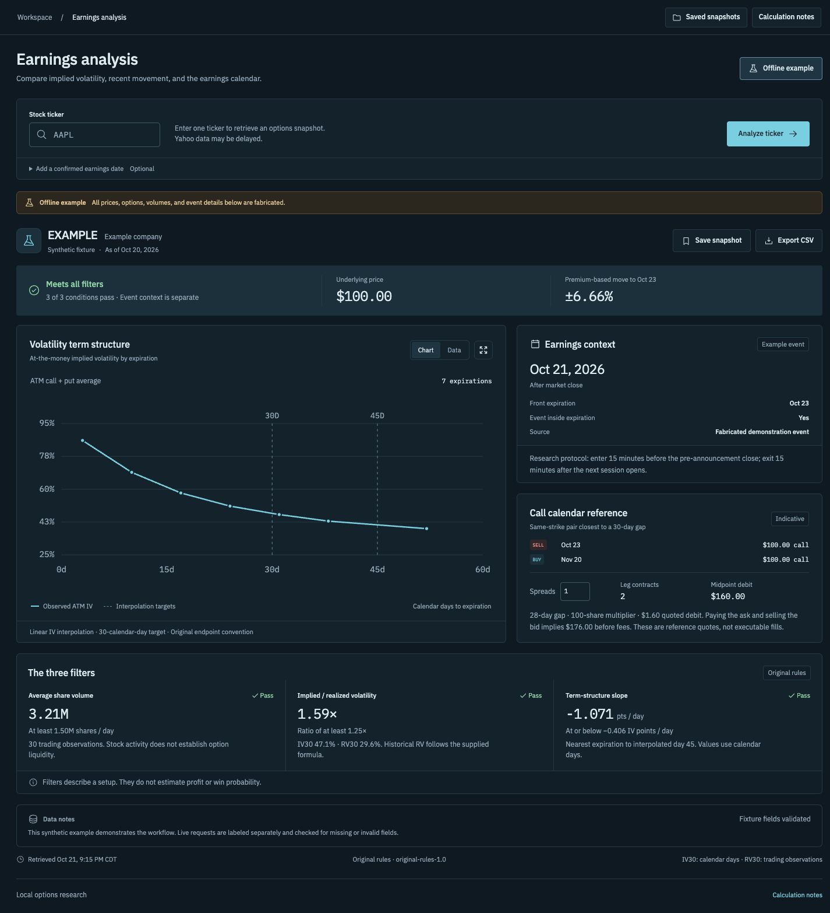

# Earnings Lab

A Python options-research tool that runs on your computer and opens in your browser. Analyze a ticker's implied volatility, recent realized movement, earnings timing, and an indicative calendar spread. Save results locally or export them as CSV.



## Launch

**Python 3.12+ required.** The prepared release includes the interface; Node.js is not required.

1. Download and extract `earnings-lab-v0.1.3.zip` from [Releases](https://github.com/zachmoss4/earnings-lab/releases/latest).
2. On macOS, open `Launch.command`, or run this in the extracted folder:

   ```sh
   python3 launch.py
   ```

3. The calculator opens at `http://127.0.0.1:8765`. Keep the terminal open while using it. Ctrl+C stops it.

The first launch creates a Python environment and installs pinned dependencies. No API key is required. Market-data requests require internet access; the optional offline example does not.

### Run from source

Python 3.12+ and Node.js 22.12+ are needed for the first interface build.

```sh
git clone https://github.com/zachmoss4/earnings-lab.git
cd earnings-lab
python3 launch.py
```

The launcher installs dependencies and builds the interface if needed. It serves the application on your computer's loopback address.

## Use

Enter a USD equity ticker and select **Analyze ticker**. Review the curve, filter measurements, event timing, and quote notes. A confirmed earnings date/session can be entered separately when available.

- **Saved snapshots:** reopen a saved result without refreshing its prices.
- **Save snapshot:** preserve the current measurements, settings, and retrieval time.
- **Export CSV:** download the result with units, thresholds, and data-source fields.
- **Calculation notes:** inspect the rules and conventions.
- **Offline example:** explicitly load fabricated, labeled data for a demonstration.

Snapshots are stored in `.local/snapshots/` and excluded from Git and release packages.

## Filters

| Measurement | Passing condition |
| --- | --- |
| Mean stock volume, 30 observations | ≥ 1,500,000 shares/day |
| IV30 / historical realized volatility | ≥ 1.25 |
| Nearest-to-45-day IV slope | ≤ −0.00406 decimal IV/calendar day |

The slope cutoff equals −0.406 volatility percentage points per day. The tool uses linear IV interpolation and a reference OHLC volatility estimate annualized with 252 trading days. [Calculation details](docs/methodology.md) explain the conventions and input checks.

Quotes and event dates may be delayed or incomplete. Retrieval time is not a verified quote timestamp. The tool displays filter matches and indicative costs; it does not place orders, forecast returns, or include a historical backtest.

## Development

```sh
.venv/bin/python -m unittest discover -s tests -v
npm run check
npm run build
```

[Architecture](docs/architecture.md) · [Verification](docs/verification.md) · [Dependency licenses](THIRD_PARTY_NOTICES.md)

## Troubleshooting

- **Python version error:** install Python 3.12 or later.
- **Command file does not open:** run `python3 launch.py` in a terminal.
- **Port already occupied:** stop the previous launcher or use `python3 launch.py --port 8766`.
- **Data request fails:** check the symbol and the reported error, then retry. The offline example is available separately.
- **Source checkout cannot build:** install Node.js 22.12+ or use the prepared release ZIP.
