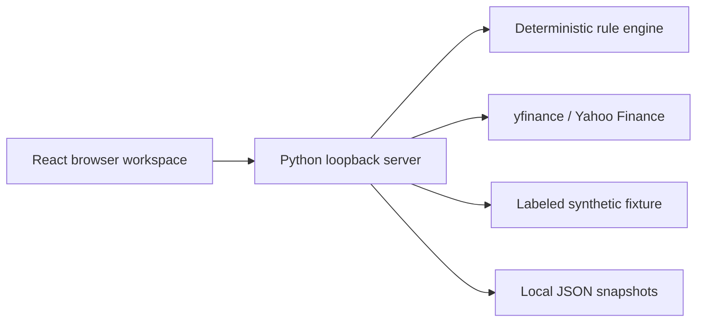

# Architecture and development

The browser and Python process run on the same computer. One loopback-only HTTP server serves the built React interface and JSON API. No cloud account, AI key, database service, or brokerage account is required.



| Location | Responsibility |
|---|---|
| `reference/calculator.py` | Numerical regression reference |
| `earnings_lab/engine.py` | Pure calculations, classifications, units, validation |
| `earnings_lab/provider.py` | Yahoo adapter and explicit event uncertainty |
| `earnings_lab/example.py` | Deterministic offline inputs |
| `earnings_lab/server.py` | Local API, bounded analysis concurrency, local storage |
| `web/` | React/TypeScript interface and CSS tokens |
| `launch.py`, `Launch.command` | Environment setup and local launch |
| `tests/` | Numerical parity, edge cases, provider contracts, API persistence |

## Development

Python 3.12+; Node.js 22.12+ for frontend builds. The exact tested Python dependency set is in `requirements-tested.txt`; JavaScript dependencies use `package-lock.json`.

```sh
python3 -m venv .venv
.venv/bin/python -m pip install -r requirements.txt
npm ci
```

For interface changes, run the API in one terminal and Vite in another:

```sh
.venv/bin/python -m earnings_lab.server
npm run dev
```

Vite serves `http://127.0.0.1:5173` and proxies `/api` to the local Python process on port 8765. The normal launch path builds the UI and serves everything from port 8765. `npm run preview` previews static assets only; use the Python server or Vite proxy for functional API requests.

```sh
.venv/bin/python -m unittest discover -s tests -v
npm run check
npm run build
```

## Local storage and connection boundaries

Saved snapshots live in `.local/snapshots/` and are ignored by Git. There is no telemetry, analytics endpoint, account login, or browser-side request to Yahoo. Live analyses contact Yahoo through Python. The first launch downloads dependencies; packaged-release UI assets and fonts then run locally.

The server binds to `127.0.0.1`, checks Host/Origin headers, restricts JSON body size, and accepts only known snapshot identifiers. It is intended for local use and has no production authentication or public-server hardening. Do not change the bind address to expose it remotely.

The app has no trade execution and does not load unrelated credentials from the user's shell into request payloads. Local snapshots and raw research sources are excluded from Git and release packaging.

## Release build

After a successful interface build:

```sh
python3 scripts/package_release.py
```

The ZIP contains the prebuilt interface, app source, pinned dependencies, documentation, and launcher. It omits the virtual environment, Node modules, local snapshots, local working data, and Git metadata. A release consumer needs Python 3.12+ but does not need Node to rebuild the packaged UI.

